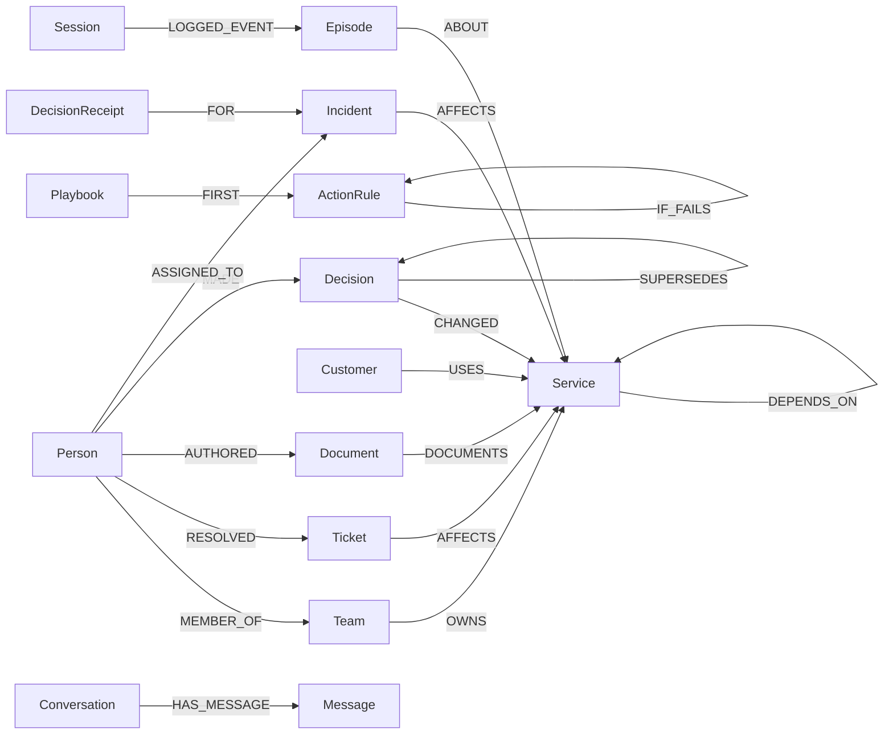
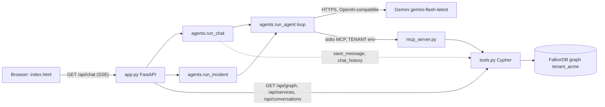

# Graph Brain (PulseGraph): project guide

Graph Brain is an AI DevOps assistant built on a company knowledge graph stored in FalkorDB. Services, owners, tickets, runbooks, architecture decisions, customers, past incidents and the chat history itself all live in one FalkorDB graph per tenant. Two LLM agents (Gemini Flash, `gemini-flash-latest`) answer questions and handle live alerts by reading and writing that graph. The UI name is "Graph Brain"; the author also calls the project PulseGraph, but that name does not appear in the code.

This guide is grounded in the source files: `seed.py`, `tools.py`, `mcp_server.py`, `agents.py`, `app.py`, `static/index.html`, `test_graph.py`, `requirements.txt` and `docker-compose.yml`. If this guide and the code disagree, the code is right.

## Table of contents

1. [What the project does](#1-what-the-project-does)
2. [Hackathon rules & compliance](#2-hackathon-rules--compliance)
3. [Graph data model](#3-graph-data-model)
4. [Graph analytics](#4-graph-analytics)
5. [Self-mutating procedural memory](#5-self-mutating-procedural-memory)
6. [Counterfactual sandbox and decision receipts](#6-counterfactual-sandbox-and-decision-receipts)
7. [Architecture](#7-architecture)
8. [Frontend](#8-frontend)
9. [Setup and run](#9-setup-and-run)
10. [Tests](#10-tests)
11. [Tool reference](#11-tool-reference)
12. [Configuration](#12-configuration)
13. [Known limitations](#13-known-limitations)

## 1. What the project does

The app has two modes, selected with the Ask / Incident toggle in the composer.

| Mode | Input | What happens |
|---|---|---|
| **Ask** | A question, e.g. "who should I page for auth-service?" | One "company brain" agent calls graph tools over MCP and answers in markdown, citing node ids in square brackets such as `[p7]`, `[T-033]`, `[DEC-3]`. |
| **Incident** | An alert, e.g. "auth-service is returning 401s" | A **triage agent** measures blast radius, finds experts and recent decisions, and writes an `Incident` node. A **remediation agent** then reads that node, follows the runbook, assigns one person, and logs an episode. The stream emits a `handoff` event between the two. |

The README maps the work to three tracks:

| Track | Where it shows up |
|---|---|
| 1. Agents acting on connected data | `search_knowledge`, `service_overview`, `get_blast_radius` (multi-hop `DEPENDS_ON` plus PageRank), `find_expert_path` (paths as evidence), all exposed over MCP |
| 2. Memory and coordination | Chat as `Conversation -> Message`; episodes as `Session -> Episode`; runbooks as a `Playbook` chain of `ActionRule` nodes; the agents hand off only through an `Incident` node |
| 3. Company brain | Ownership (`Team -OWNS-> Service`), decision lineage (`Decision -SUPERSEDES-> Decision`), and live writes from the agents |

## 2. Hackathon rules & compliance

This project is strictly designed and audited against the FalkorDB Hackathon rules:

| Rule | Requirement | How Graph Brain Complies |
|---|---|---|
| **Rule 2: Required Technology** | FalkorDB must be the primary graph database supporting a central part of the product. | FalkorDB is the sole source of truth and state engine for all services, dependencies, team mappings, decisions, incident playbooks, episodes, and multi-agent coordination. |
| **Rule 3: Real Work (Not Decoration)** | The graph has to do real work. If the product still works without FalkorDB, it fails. | The entire MCP server, agent tool loop, PageRank calculation, multi-hop blast radius, and incident handoff halt completely without FalkorDB. The graph is the system of execution, not just a visualization. |
| **Rule 4: FalkorDB Deployment** | Docker, self-hosted, or FalkorDB Cloud accepted. Any framework/frontend. | Supports 1-command Docker Compose (`falkordb/falkordb:latest`) and FalkorDB Cloud via `FALKORDB_URL` in `.env`. Web UI built with modern HTML/CSS/JS with Cytoscape.js and FastAPI SSE. |
| **Rule 5: Challenge Tracks** | Open-ended across 3 tracks: Agents That Act on Connected Data, Agent Memory and Coordination, Company Brain. Must name all entered tracks. | Graph Brain enters **all 3 tracks**: (1) Connected Data agents via MCP and PageRank, (2) Decoupled Memory & Coordination via FalkorDB `Incident` handoff and procedural runbook rewiring, (3) Company Brain institutional knowledge and decision lineage. |
| **Rule 6: Data Restrictions** | Must use allowed data (public, synthetic, or own). No private, restricted, or paywalled data. | 100% synthetic company data generated deterministically by `seed.py`. Zero proprietary or private credentials used. |
| **Submission Checklist** | Public repo, README with setup + graph model + Cypher queries/algorithms, demo video, local setup, track names, AI disclosure. | `README.md` includes complete graph data models, 9 documented Cypher queries/algorithms, multi-agent architecture sequence, foolproof setup guides, demo video script, and AI disclosure. |

## 3. Graph data model

`seed.py` builds a hand-written company, `acme` by default (`python seed.py [tenant]`). It contains 5 teams, 15 people, 30 services, 40 tickets, 19 tier-1 runbook documents, 6 decisions, 5 customers, 6 playbooks with 23 action steps, and one past episode.



Notes on the model:

- **Services and dependencies.** 30 services, each with a tier. `DEPENDS_ON` points from the dependent to the thing it needs, e.g. `auth-service -> postgres-main`.
- **People, teams and tickets.** Each `Ticket` has an `issue_type` and is closed. A person `RESOLVED` a ticket, and the ticket `AFFECTS` a service. The seed picks the resolver from the owning team 75% of the time and from anyone otherwise.
- **Decisions.** Six of them. `DEC-5` (raise redis-cache maxmemory to 16GB) `SUPERSEDES` `DEC-4` (cap it at 8GB).
- **Customers.** `(:Customer)-[:USES]->(:Service)`, with a `vip` flag. Globex, Initech and Umbrella Health are VIP. Hooli and Pied Piper are not.
- **Playbooks.** One `Playbook` per issue type (`latency`, `outage`, `memory_leak`, `auth_failure`, `data_loss`, `config_drift`). Each is a chain `(:Playbook)-[:FIRST]->(:ActionRule)-[:NEXT]->...`. Three steps have fallbacks: `latency` step 2, `auth_failure` step 1 and `outage` step 2, each linked with `-[:IF_FAILS]->` to a fallback `ActionRule`.
- **Incident.** Created by the triage agent with status `triaged`. Assigning changes the status to `assigned` and stores the plan. It is the hand-off state between the two agents.
- **Session and Episode.** Episodic memory. `Episode` nodes hold the agent, issue type and summary, and point at a service with `ABOUT`. The seed adds one past episode on auth-service.
- **Conversation and Message.** Chat history. A conversation's title is the first 60 characters of its first user message.
- **DecisionReceipt.** Written by `compare_actions` when it is given an incident id. It is linked to the incident with `FOR`.

## 4. Graph analytics

These are the read functions in `tools.py`.

| Function | What it computes |
|---|---|
| `get_blast_radius(service_id, max_hops=3)` | Services that reach the target over `DEPENDS_ON`, clamped to 1 to 6 hops. Each row carries tier, owning team, hop count and PageRank. Also returns the customers whose services reach the target, with the path for each. |
| `criticality()` | PageRank over `DEPENDS_ON` via `algo.pageRank`. Services many others lean on score high. |
| `find_expert_path(service_id, issue_type)` | People who resolved tickets of that issue type on the service or a neighbour, each with evidence paths. Also returns the owning team. |
| `decision_lineage(service_id)` | Decisions that changed the service, each with the decision it superseded. The newest comes first. |
| `search_knowledge(query)` | Keyword search. Uses the first 8 query words longer than 2 characters and matches them as substrings over services, people, teams, tickets, documents, decisions, incidents, episodes and customers. Returns up to 12 hits, each with up to 8 direct links, so the agent knows where to look next. |
| `service_overview(service_id)` | Owner, team members, dependencies, runbook documents with authors, and incidents on the service. |
| `recall_memory(service_id, issue_type)` | Episodes on the service plus the playbook steps for the issue type. |

Customer reachability follows `DEPENDS_ON*0..4`, so a customer is found when its service reaches the target within 4 hops.

## 5. Self-mutating procedural memory

Runbooks are graph edges, not text. The agents follow the chain in order, and operators can rewrite it from chat. The next incident follows the new path with no code change.

`get_runbook(issue_type)` returns the ordered steps. Each step has an id such as `R-latency-2`, its text, and an `if_fails` object when a fallback exists. Changed fallbacks also carry `changed_by` and `reason`.

`update_runbook(issue_type, op, step_id, text, reason, changed_by)` supports four operations:

| `op` | Effect |
|---|---|
| `replace` | New text for `step_id`. Needs non-empty text. |
| `insert_after` | New step after `step_id`, relinking `NEXT`. Needs text. |
| `remove` | Drops `step_id` and relinks `NEXT` (or `FIRST`) around it. Refuses to remove the only step of a runbook. |
| `set_fallback` | Sets what happens if `step_id` fails. |

An unknown `op` or an unknown step id raises a `ValueError`. The function is not transactional: each op runs several queries, which the code comment flags as a concern under concurrent edits.

A typical request is "if this check fails, do this instead". The chat agent calls `get_runbook`, then `update_runbook` with `op: set_fallback`, the step id it returned, and the new text. The change is stored in the graph, so the remediation agent reads it in the next incident.

Only the chat agent has `update_runbook` in its tool set. Its prompt tells it to change a runbook only when the user asks.

## 6. Counterfactual sandbox and decision receipts

Before a disruptive step (restart, failover, rollback), the remediation agent calls `compare_actions` with the incident id. It compares the candidate action against an alternative, such as draining traffic, which takes no services down. Each candidate lists the services it takes offline.

For each action, `compare_actions` works out:

- which services go down, including the services that depend on them;
- which customers are hit, and whether any are VIP;
- a risk score, based on the PageRank of the affected services.

The safer action is the one with fewer VIP customers hit, then fewer customers hit, then lower risk. On a tie, action A is chosen. With an `incident_id`, the result is stored as a `DecisionReceipt` linked to the incident with `FOR`.

The test suite checks this on the seed data: a restart of `postgres-main` is rejected because it reaches VIP customers, and the drain option is chosen. The receipt is drawn in the evidence graph with the chosen path in green and the rejected path in red.

## 7. Architecture



The request path for one chat turn:

1. The browser opens an `EventSource` on `GET /api/chat` with `message`, `conversation`, `mode` (`ask` or `incident`) and `tenant`.
2. `app.py` returns a `StreamingResponse`. A background task runs the agent and pushes each event onto a queue, which is written out as `data: {json}` lines.
3. `agents.run_chat` loads the last 20 messages of the conversation from the graph, saves the user message, and starts `mcp_server.py` as a stdio subprocess with `TENANT` set.
4. `run_agent` lists the MCP tools, keeps only the names in the agent's allowed set, and runs a manual tool loop against Gemini, capped at 15 turns. Each tool call goes to the MCP server, which runs the matching function in `tools.py`.
5. The last text the agent produced is saved as the assistant message, and a `done` event carries it as `answer`.

Key points about the design:

- **One process per tenant.** `mcp_server.py` reads `TENANT` once, so a process reaches only its own graph. `run_chat` and `run_incident` start a fresh MCP subprocess for each call.
- **Tool sets per agent.** `agents.py` defines `TRIAGE_TOOLS`, `REMEDIATION_TOOLS` and `CHAT_TOOLS`. The MCP server exposes all 13 tools, but each agent sees only its own set. See [section 10](#10-tool-reference).
- **Hand-off through the graph.** The remediation agent works from the incident id it is given and reads the rest from the graph with `get_incident`. The graph is the only channel between the two agents.
- **Gemini client.** Standard library only (`urllib`), no SDK. It posts to Gemini's OpenAI-compatible chat completions endpoint. On HTTP 429 it sleeps 15 seconds and retries, for up to 5 attempts in total.
- **Errors.** `mcp_server.py` converts `ValueError` into an MCP tool error so the model sees the message, for example "no step R-x in the latency runbook". `app.py` unwraps `ExceptionGroup` from the MCP task group and sends the real cause as an `error` event.

### SSE events

| `kind` | Fields | Used for |
|---|---|---|
| `tool_call` | `agent`, `tool`, `input` | One step in the run |
| `tool_result` | `agent`, `tool`, `output`, `error` | Result of a step. Results from `compare_actions` are shown as decision receipts. |
| `text` | `agent`, `text` | Agent prose |
| `handoff` | `incident_id` | Triage has finished and remediation is starting |
| `done` | `answer` (chat) or `incident` (object) | Final result |
| `error` | `text` | Failure message |

### HTTP endpoints (`app.py`)

| Method and path | Purpose |
|---|---|
| `GET /` | Serves `static/index.html` |
| `GET /api/chat` | SSE chat. `mode=ask` runs the company brain and saves the answer. `mode=incident` runs triage then remediation, then saves the summary as an assistant message. |
| `GET /api/incident` | SSE incident run. It emits `done` with an `incident` object and saves no messages. |
| `GET /api/services` | Service ids |
| `GET /api/graph/{service_id}` | Nodes and edges for the evidence graph |
| `GET /api/conversations` | Conversations, newest first |
| `GET /api/conversations/{cid}` | Up to 200 messages of one conversation |

Every endpoint takes a `tenant` query parameter, default `acme`. The tenant must be a valid Python identifier because it becomes part of the graph name.

### Files

| File | Role |
|---|---|
| `tools.py` | All Cypher, plus the `.env` reader and the chat helpers that the MCP server does not expose |
| `mcp_server.py` | MCP server `devops-graph` over stdio. Thin wrappers over `tools.py`. |
| `agents.py` | Prompts, tool sets, Gemini client, the manual tool loop, `run_chat` and `run_incident`. Runnable from the CLI. |
| `app.py` | FastAPI app and SSE plumbing |
| `static/index.html` | Single-file UI with inline CSS and JS |
| `seed.py` | Rebuilds one tenant graph from hand-written data |
| `test_graph.py` | Graph self-check against a live FalkorDB |
| `docker-compose.yml` | Runs FalkorDB. It publishes ports 6379 and 3000; the file's comment describes 3000 as the FalkorDB browser UI. |
| `requirements.txt` | Python dependencies, including `falkordb`, `fastapi`, `uvicorn` and `mcp` |

`app.py` uses the built-in `ExceptionGroup`, which needs Python 3.11 or newer.

## 8. Frontend

`static/index.html` is one file with no build step. It loads its libraries from CDNs and its fonts from Google Fonts.

Layout:

- **Left sidebar.** Conversation history, with a way to start a new chat.
- **Centre.** The thread and the composer. An empty chat shows seven starter cards, including "Simulate crisis", "Rewrite a runbook from chat" and "Restart or reroute?". The composer has the Ask and Incident toggles.
- **Right panel.** The evidence graph. Decision receipts draw the chosen path in green and the rejected path in red.

## 9. Setup and run

Prerequisites: Python 3.11 or newer, and either Docker or a reachable FalkorDB instance.

1. **Start FalkorDB.**

   With Docker:
   ```bash
   docker compose up -d
   ```

   With another FalkorDB host, set `FALKORDB_URL` in `.env` to its Redis-protocol URL.

2. **Install the dependencies.** On Windows:
   ```bash
   python -m venv .venv
   .venv\Scripts\activate
   pip install -r requirements.txt
   ```

3. **Seed the graph and run the checks.**
   ```bash
   python seed.py            # seeds tenant_acme
   python seed.py globex     # any other tenant name
   python test_graph.py
   ```
   `seed.py` deletes the tenant graph and rebuilds it with a fixed random seed, so the data is the same every time. Re-seeding wipes that tenant's chat history too.

4. **Add a Gemini key.** Get a key from Google AI Studio and put `GEMINI_API_KEY=...` in `.env`. The chat and incident agents need it. Seeding and the tests do not call Gemini.

5. **Run the agents from the CLI** (optional):
   ```bash
   python agents.py "auth-service is returning 401s for 30% of logins"
   ```
   Each event is printed as a JSON line, cut to 400 characters.

6. **Run the web app:**
   ```bash
   uvicorn app:app --reload
   ```
   Open http://localhost:8000.

To run the MCP server by itself for a stdio client: `TENANT=acme python mcp_server.py`.

## 10. Tests

`python test_graph.py` checks the graph layer against a live FalkorDB. It does not call Gemini, FastAPI or the UI. It seeds a separate tenant `selftest`, runs the assertions, deletes the graphs and prints `all graph checks passed`. A failed assertion stops the script with a traceback.

What it covers:

- **Blast radius.** `redis-cache` impact includes `rate-limiter`, `api-gateway` and `checkout`, with checkout three hops up. `postgres-main` is not in it. PageRank ranks `redis-cache` above `checkout`.
- **Experts and owners.** `find_expert_path` returns `identity` as the owning team of auth-service, and every expert has evidence.
- **Decisions.** `decision_lineage` for redis-cache returns `DEC-5` then `DEC-4`, and `DEC-5` names the decision it superseded.
- **Memory.** `recall_memory` returns an episode and four playbook steps for auth-service.
- **Incident lifecycle.** Create, read, assign, then reassign. After reassignment there is exactly one `ASSIGNED_TO` edge, to the new person.
- **Logging.** `log_episode` adds a second episode.
- **Input errors.** Unknown service or incident ids raise `ValueError`, and a failed `log_episode` leaves no orphan `Session`.
- **Search and overview.** `search_knowledge` ranks the runbook document first for a runbook question. A query of two short words returns nothing. `service_overview` returns the owner, docs and the incident.
- **Chat history.** Saves and reads back two messages in order. The conversation title comes from the first message.
- **Evidence graph.** `subgraph` for auth-service includes an `Incident` node and edges.
- **Runbook edits.** `set_fallback` records `changed_by`; `insert_after`; `remove` at the start and in the middle, which relinks `NEXT`. Unknown step ids, unknown ops, and `replace` with empty text all raise.
- **Customer paths.** Each path starts at a customer and ends at postgres-main.
- **Counterfactual.** `compare_actions` chooses the drain option, the restart option hits VIPs, a receipt is linked to the incident, and an unknown service raises.
- **Tenant isolation.** A second tenant graph is empty.

## 11. Tool reference

### MCP tools (`mcp_server.py`)

All 13 tools are exposed by the `devops-graph` server. The "Used by" column lists which agent's tool set in `agents.py` includes each one.

| Tool | Purpose | Used by |
|---|---|---|
| `get_blast_radius(service_id, max_hops=3)` | Upstream dependents with tier, owner and PageRank, plus the customers reached | triage, chat |
| `find_expert_path(service_id, issue_type)` | People who resolved that issue type on the service or a neighbour, with paths | triage, remediation, chat |
| `decision_lineage(service_id)` | Decisions that changed the service, with what each superseded | triage, chat |
| `recall_memory(service_id, issue_type)` | Past episodes on the service and the playbook for the issue type | triage, remediation, chat |
| `search_knowledge(query)` | Keyword search across the graph, with each hit's direct links | chat |
| `service_overview(service_id)` | Owner, members, dependencies, docs and incidents | chat |
| `create_incident(service_id, issue_type, summary, suspected_root_cause, candidate_assignees)` | Writes the `Incident` node with status `triaged` | triage |
| `get_incident(incident_id)` | Reads an incident, including its assignee and plan | remediation, chat |
| `assign_incident(incident_id, person_id, plan)` | Assigns one person, stores the plan, sets status `assigned` | remediation |
| `log_episode(session_id, agent, service_id, issue_type, summary)` | Writes an `Episode` under a `Session` | remediation |
| `get_runbook(issue_type)` | Ordered steps with ids and fallbacks | remediation, chat |
| `update_runbook(issue_type, op, step_id, text, reason, changed_by)` | Rewires the runbook (`replace`, `insert_after`, `remove`, `set_fallback`) | chat |
| `compare_actions(action_a, takes_down_a, action_b, takes_down_b, incident_id)` | Counterfactual comparison and the chosen action; stores a receipt when given an incident id | remediation, chat |

### Agent tool sets

| Agent | Tools |
|---|---|
| Triage | `get_blast_radius`, `find_expert_path`, `decision_lineage`, `recall_memory`, `create_incident` |
| Remediation | `get_incident`, `recall_memory`, `get_runbook`, `find_expert_path`, `compare_actions`, `assign_incident`, `log_episode` |
| Chat (company brain) | `search_knowledge`, `service_overview`, `get_blast_radius`, `find_expert_path`, `decision_lineage`, `recall_memory`, `get_incident`, `get_runbook`, `update_runbook`, `compare_actions` |

Only the chat agent can call `search_knowledge`, `service_overview` and `update_runbook`. Only the triage agent can call `create_incident`, and only the remediation agent can call `assign_incident` and `log_episode`.

### Functions in `tools.py` that are not MCP tools

These are called by `app.py` and `agents.py` directly:

| Function | Purpose |
|---|---|
| `save_message(tenant, conversation_id, role, text)` | Appends a message to a conversation |
| `chat_history(tenant, conversation_id, limit=20)` | Last messages, oldest first |
| `list_conversations(tenant)` | Recent conversations |
| `subgraph(tenant, service_id)` | Nodes and edges for the evidence graph |
| `criticality(tenant)` | PageRank for all services |

## 12. Configuration

| Name | Where | Purpose |
|---|---|---|
| `FALKORDB_URL` | `.env` or environment | FalkorDB connection URL |
| `GEMINI_API_KEY` | `.env` or environment | Gemini API key, needed by the agents |
| `TENANT` | Set by `agents.py` for the MCP subprocess | Tenant that `mcp_server.py` is bound to. Defaults to `acme` if unset. |

`tools.py` reads `.env` at import time with a small `KEY=VALUE` parser and sets each value with `setdefault`, so real environment variables take precedence. Do not commit `.env`.

## 13. Known limitations

From the code and its comments:

- **Gemini rate limits.** A 429 response makes the client wait 15 seconds and retry, up to 5 attempts in total. If the quota is still exhausted, the UI shows the Gemini error.
- **`update_runbook` is not transactional.** Each op runs several queries. The code comment says it should become one Cypher statement per op under concurrency.
- **Search is substring matching.** `search_knowledge` ranks by the number of word hits. A comment in `tools.py` says to use a full-text or vector index at scale.
- **Re-seeding a tenant wipes its chats.** `seed.py` deletes the whole tenant graph, including `Conversation` nodes.
- **Runbook length is capped.** Runbook queries walk at most 20 `NEXT` hops, so longer runbooks are cut short.
- **Assignment is one person.** `assign_incident` replaces any earlier assignee.
- **A failed chat turn leaves an unanswered question.** `run_chat` saves the user message before the agent runs, so an error leaves it in history with no reply.
- **Reopening a past conversation** shows the saved text only. Trace steps and receipt cards are not stored.
- **Tests leave a graph behind on failure.** `test_graph.py` deletes the graphs at the end. If a run fails midway, the graph stays and the next run rebuilds it.
- **Model alias.** The agents use `gemini-flash-latest`, which Google may change at any time.
- **Tenant selector.** The UI works with one tenant; the API accepts any valid tenant name.
